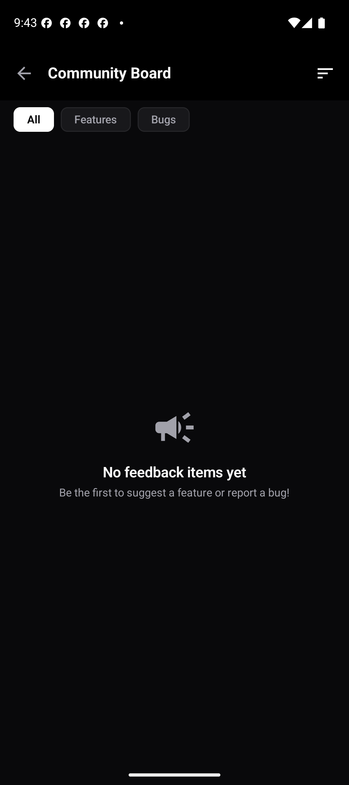

# Feeddo Android SDK

Drop a live AI support chat, customer feedback, and community board into your Android app with just a few lines of Kotlin.

## What is Feeddo?

Feeddo is an AI-powered customer support and feedback widget for your Android app — a modern, lightweight, native **Intercom alternative for Android**:

- **AI Support Agent** — Answers customer inquiries instantly using your docs and knowledge base.
- **Auto Support Tickets** — Seamlessly creates support tickets when an issue requires human attention.
- **Live Chat** — Chat in real-time with users with typing indicators and read receipts.
- **Smart Bug Tracking** — Collects details and automatically files bug reports.
- **Feature Requests & Community Board** — Let users request features, vote on priorities, and leave comments.
- **In-App Notification Banners** — Slide-in top banners for unread messages and system updates.

---

## Screenshots

<p align="center">
  
  &nbsp;&nbsp;&nbsp;&nbsp;
  
  &nbsp;&nbsp;&nbsp;&nbsp;
  
</p>

---

## Installation

Add the Feeddo SDK dependency to your Android project:

### 1. In `settings.gradle.kts`:
```kotlin
dependencyResolutionManagement {
    repositories {
        google()
        mavenCentral()
    }
}
```

### 2. In your app `build.gradle.kts`:
```kotlin
dependencies {
    implementation(project(":feeddo-sdk"))
    // Or via Maven Central / AAR:
    // implementation("dev.feeddo:feeddo-sdk:1.0.0")
}
```

---

## Quickstart

### 1. Get Your API Key
Sign up at [feeddo.dev](https://feeddo.dev) and grab your API key from the dashboard.

### 2. Initialize Feeddo
Initialize the SDK at app launch (e.g., in your `Application` or main `Activity`):

```kotlin
import dev.feeddo.sdk.Feeddo
import dev.feeddo.sdk.theme.FeeddoTheme

class MainActivity : ComponentActivity() {
    override fun onCreate(savedInstanceState: Bundle?) {
        super.onCreate(savedInstanceState)

        lifecycleScope.launch {
            val userId = Feeddo.init(
                context = this@MainActivity,
                apiKey = "YOUR_FEEDDO_API_KEY", // Get from feeddo.dev
                userName = "Jane Doe",
                email = "jane@example.com",
                userSegment = "premium",
                theme = FeeddoTheme.dark(), // or FeeddoTheme.light()
                isInAppNotificationOn = true
            )
            println("Feeddo initialized with user ID: $userId")
        }
    }
}
```

### 3. Open Support Home
Launch the complete support center (chat, recent conversations, tickets, and FAQs):

```kotlin
Feeddo.show(context)
```

### 4. Open Community Board
Open feature requests and bug reports directly:

```kotlin
Feeddo.showCommunityBoard(context)
```

---

## Push Notifications (FCM)

Feeddo supports remote push notifications via Firebase Cloud Messaging (FCM). When the app is in the foreground, Feeddo automatically presents an in-app banner; when in the background, a system notification is shown.

### 1. Setup Firebase Messaging Service
Create a service extending `FirebaseMessagingService`:

```kotlin
class MyFirebaseMessagingService : FirebaseMessagingService() {

    override fun onNewToken(token: String) {
        super.onNewToken(token)
        CoroutineScope(Dispatchers.IO).launch {
            Feeddo.registerPushToken(token, FeeddoPushProvider.FCM)
        }
    }

    override fun onMessageReceived(remoteMessage: RemoteMessage) {
        super.onMessageReceived(remoteMessage)

        if (Feeddo.isAppInForeground) {
            // App in foreground: show Feeddo in-app overlay banner
            Feeddo.handleForegroundNotification(
                data = remoteMessage.data,
                title = remoteMessage.notification?.title,
                message = remoteMessage.notification?.body
            )
        } else {
            // App in background: show system tray notification
            showSystemNotification(remoteMessage)
        }
    }
}
```

### 2. Handle Notification Taps
In your main activity's `onCreate` and `onNewIntent`:

```kotlin
override fun onNewIntent(intent: Intent) {
    super.onNewIntent(intent)
    handlePushIntent(intent)
}

private fun handlePushIntent(intent: Intent?) {
    val extras = intent?.extras ?: return
    val dataMap = extras.keySet().associateWith { extras.getString(it) }

    if (dataMap.containsKey("conversationId") || dataMap.containsKey("taskId") || dataMap.containsKey("type")) {
        lifecycleScope.launch {
            Feeddo.handleNotificationTap(this@MainActivity, dataMap)
        }
    }
}
```

---

## Unread Message Badge

Observe unread messages in real-time in Jetpack Compose:

```kotlin
val unreadCountState = Feeddo.unreadMessageCountFlow?.collectAsState()
val unreadCount = unreadCountState?.value ?: Feeddo.unreadMessageCount

if (unreadCount > 0) {
    Badge { Text("$unreadCount") }
}
```

---

## Theming

Feeddo supports Dark and Light themes out of the box, as well as full custom palettes:

```kotlin
val customTheme = FeeddoTheme(
    colors = FeeddoColors(
        background = Color(0xFF0F172A),
        cardBackground = Color(0xFF1E293B),
        textPrimary = Color(0xFFF8FAFC),
        textSecondary = Color(0xFF94A3B8),
        primary = Color(0xFF38BDF8),
        border = Color(0xFF334155),
        divider = Color(0xFF1E293B),
        appBarBackground = Color(0xFF0F172A)
    ),
    isDark = true
)

Feeddo.show(context, theme = customTheme)
```
