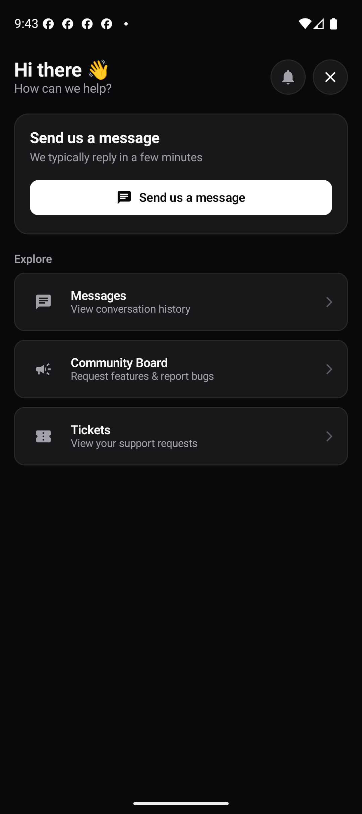
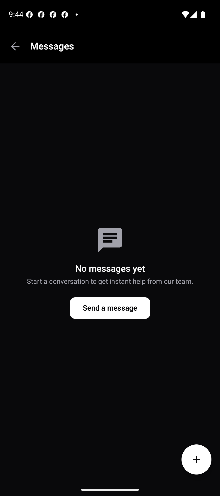

# Feeddo Android SDK

Drop a live AI support chat, customer feedback, and community board into your Android app with just a few lines of Kotlin.

## What is Feeddo?

Feeddo is an AI-powered customer support and feedback widget for your Android app — a modern, lightweight, native **Intercom alternative for Android**:

- **AI Support Agent** — Answers customer inquiries instantly using your docs and knowledge base.
- **Auto Support Tickets** — Seamlessly creates support tickets when an issue requires human attention.
- **Live Chat** — Chat in real-time with users with typing indicators and read receipts.
- **Smart Bug Tracking** — Collects details and automatically files bug reports.
- **Feature Requests & Community Board** — Let users request features, vote on priorities, and leave comments.
- **In-App Notification Banners** — Slide-in top banners for unread messages and system updates.

---

## Screenshots

<p align="center">
  
  &nbsp;&nbsp;&nbsp;&nbsp;
  
  &nbsp;&nbsp;&nbsp;&nbsp;
  
</p>

---

## Installation

Add the Feeddo SDK dependency to your Android project:

### 1. In `settings.gradle.kts`:
```kotlin
dependencyResolutionManagement {
    repositories {
        google()
        mavenCentral()
    }
}
```

### 2. In your app `build.gradle.kts`:
```kotlin
dependencies {
    implementation(project(":feeddo-sdk"))
    // Or via Maven Central / AAR:
    // implementation("dev.feeddo:feeddo-sdk:1.0.0")
}
```

---

## Quickstart

### 1. Get Your API Key
Sign up at [feeddo.dev](https://feeddo.dev) and grab your API key from the dashboard.

### 2. Initialize Feeddo
Initialize the SDK at app launch (e.g., in your `Application` or main `Activity`):

```kotlin
import dev.feeddo.sdk.Feeddo
import dev.feeddo.sdk.theme.FeeddoTheme

class MainActivity : ComponentActivity() {
    override fun onCreate(savedInstanceState: Bundle?) {
        super.onCreate(savedInstanceState)

        lifecycleScope.launch {
            val userId = Feeddo.init(
                context = this@MainActivity,
                apiKey = "YOUR_FEEDDO_API_KEY", // Get from feeddo.dev
                userName = "Jane Doe",
                email = "jane@example.com",
                userSegment = "premium",
                theme = FeeddoTheme.dark(), // or FeeddoTheme.light()
                isInAppNotificationOn = true
            )
            println("Feeddo initialized with user ID: $userId")
        }
    }
}
```

### 3. Open Support Home
Launch the complete support center (chat, recent conversations, tickets, and FAQs):

```kotlin
Feeddo.show(context)
```

### 4. Open Community Board
Open feature requests and bug reports directly:

```kotlin
Feeddo.showCommunityBoard(context)
```

---

## Push Notifications Setup (FCM)

> [!IMPORTANT]
> **Push notifications are essential for Feeddo to work effectively.**
> Integrating push notifications ensures your users receive live developer replies, support ticket updates, community task comments, and release announcements even when your app is in the background or closed. Without push notifications, users will only see updates when they manually reopen the app.

Follow these 5 steps to configure push notifications:

### Step 1: Firebase Project Setup
1. Go to the [Firebase Console](https://console.firebase.google.com/) and open your project (or create one).
2. Add an **Android** app with your package name (e.g., `dev.feeddo.sample`).
3. Download `google-services.json` and place it in your app module directory (e.g., `app/google-services.json`).

### Step 2: Connect Feeddo Backend to Firebase (FCM)
To allow Feeddo to send push notifications to your users:
1. In [Firebase Console](https://console.firebase.google.com/) → click the **Settings** (gear icon) → **Project Settings** → **Service accounts** tab.
2. Click **Generate new private key**, then click **Generate key** to download the JSON credentials file.
3. Open your [Feeddo Dashboard](https://feeddo.dev) → **Settings** → **Notifications** → **Google (FCM)**.
4. Upload the downloaded JSON service account file and click **Save**.
5. Under **For End Users**, confirm notification triggers (New Message, Ticket Status, Community Comments) are enabled.

### Step 3: Configure Gradle & Manifest
In your project-level `build.gradle.kts`:
```kotlin
plugins {
    id("com.google.gms.google-services") version "4.4.2" apply false
}
```

In your app-level `build.gradle.kts`:
```kotlin
plugins {
    id("com.android.application")
    id("kotlin-android")
    id("com.google.gms.google-services")
}

dependencies {
    implementation(platform("com.google.firebase:firebase-bom:33.7.0"))
    implementation("com.google.firebase:firebase-messaging")
    implementation("androidx.core:core-ktx:1.15.0")
}
```

In `AndroidManifest.xml`, request notification permission and register your messaging service:
```xml
<!-- Required for Android 13+ (API 33+) -->
<uses-permission android:name="android.permission.POST_NOTIFICATIONS" />

<application ...>
    <service
        android:name=".FeeddoFirebaseMessagingService"
        android:exported="false">
        <intent-filter>
            <action android:name="com.google.firebase.MESSAGING_EVENT" />
        </intent-filter>
    </service>
</application>
```

### Step 4: Implement `FirebaseMessagingService`
Create a service extending `FirebaseMessagingService`.
- When the app is in the **foreground**, Feeddo presents an interactive in-app top banner (`Feeddo.handleForegroundNotification`).
- When the app is in the **background** or **closed**, post a system tray notification.

```kotlin
package com.example.yourapp

import android.app.NotificationChannel
import android.app.NotificationManager
import android.app.PendingIntent
import android.content.Context
import android.content.Intent
import android.os.Build
import androidx.core.app.NotificationCompat
import com.google.firebase.messaging.FirebaseMessagingService
import com.google.firebase.messaging.RemoteMessage
import dev.feeddo.sdk.Feeddo
import dev.feeddo.sdk.models.FeeddoPushProvider
import kotlinx.coroutines.CoroutineScope
import kotlinx.coroutines.Dispatchers
import kotlinx.coroutines.launch

class FeeddoFirebaseMessagingService : FirebaseMessagingService() {

    companion object {
        const val CHANNEL_ID = "feeddo_notifications_channel"
        const val CHANNEL_NAME = "Feeddo Notifications"
    }

    override fun onNewToken(token: String) {
        super.onNewToken(token)
        CoroutineScope(Dispatchers.IO).launch {
            try {
                Feeddo.registerPushToken(token, FeeddoPushProvider.FCM)
            } catch (e: Exception) {
                e.printStackTrace()
            }
        }
    }

    override fun onMessageReceived(remoteMessage: RemoteMessage) {
        super.onMessageReceived(remoteMessage)

        val data = remoteMessage.data
        val title = remoteMessage.notification?.title ?: data["title"] ?: "Feeddo"
        val body = remoteMessage.notification?.body ?: data["body"] ?: ""

        CoroutineScope(Dispatchers.Main).launch {
            if (Feeddo.isAppInForeground && Feeddo.currentActivity != null) {
                // Foreground: Show Feeddo in-app top slide banner
                Feeddo.handleForegroundNotification(
                    data = data,
                    title = title,
                    message = body
                )
            } else {
                // Background / closed: Show system tray notification
                showSystemNotification(title, body, data)
            }
        }
    }

    private fun showSystemNotification(
        title: String,
        body: String,
        data: Map<String, String>
    ) {
        val notificationManager = getSystemService(Context.NOTIFICATION_SERVICE) as NotificationManager

        if (Build.VERSION.SDK_INT >= Build.VERSION_CODES.O) {
            val channel = NotificationChannel(
                CHANNEL_ID,
                CHANNEL_NAME,
                NotificationManager.IMPORTANCE_HIGH
            ).apply {
                description = "Feeddo notifications"
            }
            notificationManager.createNotificationChannel(channel)
        }

        val intent = Intent(this, MainActivity::class.java).apply {
            flags = Intent.FLAG_ACTIVITY_CLEAR_TOP or Intent.FLAG_ACTIVITY_SINGLE_TOP
            for ((key, value) in data) {
                putExtra(key, value)
            }
        }

        val pendingIntent = PendingIntent.getActivity(
            this,
            System.currentTimeMillis().toInt(),
            intent,
            PendingIntent.FLAG_UPDATE_CURRENT or PendingIntent.FLAG_IMMUTABLE
        )

        val notification = NotificationCompat.Builder(this, CHANNEL_ID)
            .setSmallIcon(android.R.drawable.ic_dialog_info) // Replace with your app notification icon
            .setContentTitle(title)
            .setContentText(body)
            .setAutoCancel(true)
            .setPriority(NotificationCompat.PRIORITY_HIGH)
            .setContentIntent(pendingIntent)
            .build()

        notificationManager.notify(System.currentTimeMillis().toInt(), notification)
    }
}
```

### Step 5: Handle Notification Taps & Register Token
In your `MainActivity.kt`:
1. Request `POST_NOTIFICATIONS` permission on Android 13+.
2. Fetch the initial FCM token and register it with Feeddo.
3. Call `Feeddo.handleNotificationTap(this, dataMap)` in `onCreate` and `onNewIntent` to navigate directly to the conversation or community task when tapped.

```kotlin
class MainActivity : ComponentActivity() {

    override fun onCreate(savedInstanceState: Bundle?) {
        super.onCreate(savedInstanceState)

        // 1. Request notification permission (Android 13+)
        if (Build.VERSION.SDK_INT >= Build.VERSION_CODES.TIRAMISU) {
            if (ContextCompat.checkSelfPermission(this, Manifest.permission.POST_NOTIFICATIONS)
                != PackageManager.PERMISSION_GRANTED) {
                ActivityCompat.requestPermissions(this, arrayOf(Manifest.permission.POST_NOTIFICATIONS), 1001)
            }
        }

        // 2. Initialize Feeddo SDK
        lifecycleScope.launch {
            Feeddo.init(
                context = this@MainActivity,
                apiKey = "YOUR_FEEDDO_API_KEY",
                userName = "Jane Doe",
                email = "jane@example.com"
            )

            // Register FCM Token
            FirebaseMessaging.getInstance().token.addOnSuccessListener { token ->
                lifecycleScope.launch {
                    Feeddo.registerPushToken(token, FeeddoPushProvider.FCM)
                }
            }
        }

        // 3. Handle notification tap if opened from terminated state
        handlePushIntent(intent)
    }

    override fun onNewIntent(intent: Intent) {
        super.onNewIntent(intent)
        setIntent(intent)
        handlePushIntent(intent)
    }

    private fun handlePushIntent(intent: Intent?) {
        val extras = intent?.extras ?: return
        val dataMap = extras.keySet().associateWith { extras.getString(it) }

        if (dataMap.containsKey("conversationId") || dataMap.containsKey("taskId") || dataMap.containsKey("type")) {
            lifecycleScope.launch {
                Feeddo.handleNotificationTap(this@MainActivity, dataMap)
            }
        }
    }
}
```

---

## Unread Message Badge

Observe unread messages in real-time in Jetpack Compose:

```kotlin
val unreadCountState = Feeddo.unreadMessageCountFlow?.collectAsState()
val unreadCount = unreadCountState?.value ?: Feeddo.unreadMessageCount

if (unreadCount > 0) {
    Badge { Text("$unreadCount") }
}
```

---

## Theming

Feeddo supports Dark and Light themes out of the box, as well as full custom palettes:

```kotlin
val customTheme = FeeddoTheme(
    colors = FeeddoColors(
        background = Color(0xFF0F172A),
        cardBackground = Color(0xFF1E293B),
        textPrimary = Color(0xFFF8FAFC),
        textSecondary = Color(0xFF94A3B8),
        primary = Color(0xFF38BDF8),
        border = Color(0xFF334155),
        divider = Color(0xFF1E293B),
        appBarBackground = Color(0xFF0F172A)
    ),
    isDark = true
)

Feeddo.show(context, theme = customTheme)
```
